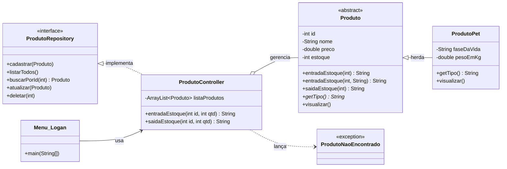

<div align="center">

# 🐱 Lojinha do Logan

Sistema de terminal em **Java puro** para gerenciar produtos e estoque de uma loja pet, com foco em Programação Orientada a Objetos e testes unitários.


[](https://github.com/Day-Barbosa/lojinha-logan/actions/workflows/ci.yml)


</div>

---

## 💡 Sobre o projeto

Uma loja pequena precisa de um jeito simples de **cadastrar produtos e controlar o estoque sem vender o que não tem**. A Lojinha do Logan faz isso pelo terminal: CRUD de produtos, entrada e saída de estoque com validação de quantidade, e mensagens coloridas para guiar a pessoa usuária. O projeto foi a avaliação final do Bloco 1 (Java e POO) da formação Java Fullstack da Generation Brasil e depois ganhou Maven, testes automatizados e CI.

<!-- 📸 MÍDIA: grave o terminal (ex.: com asciinema ou um GIF do Windows Terminal) cadastrando um produto, listando e fazendo uma saída de estoque. Salve em docs/demo.gif e troque este comentário por:
<p align="center"></p>
-->

## 🏗️ Arquitetura e decisões técnicas



| Conceito | Onde aparece |
|---|---|
| **Abstração** | `Produto` é abstrata e obriga cada subtipo a implementar `getTipo()` |
| **Herança e polimorfismo** | `ProdutoPet` estende `Produto` e sobrescreve `visualizar()` |
| **Sobrecarga** | `entradaEstoque(int)` e `entradaEstoque(int, String)` (com observação) |
| **Interface como contrato** | `ProdutoRepository` define as operações; `ProdutoController` implementa |
| **Exceção personalizada** | `ProdutoNaoEncontrado` (unchecked) é tratada no menu, sem derrubar o programa |
| **Encapsulamento** | Atributos privados com getters e setters; o estoque só muda pelas regras de entrada e saída |

## ✨ Funcionalidades

- Cadastrar, listar, buscar por id, atualizar e excluir produtos
- Entrada de estoque, com ou sem observação (ex.: número do lote)
- Saída de estoque que **bloqueia venda acima do saldo**
- Validação de quantidade zero ou negativa
- Menu interativo com cores no terminal

## 🧪 Testes

16 testes unitários com **JUnit 5**, rodando a cada push pelo GitHub Actions.

| Suíte | O que garante |
|---|---|
| `ProdutoTest` | soma e subtração de estoque, recusa de quantidade inválida, bloqueio de venda acima do saldo |
| `ProdutoControllerTest` | busca, atualização (inclusive campos de `ProdutoPet`), exclusão e `ProdutoNaoEncontrado` para ids inexistentes |

```bash
./mvnw test
```

## 🚀 Como rodar localmente

**Pré-requisito:** Java 17 ou superior. O Maven Wrapper baixa o Maven sozinho.

```bash
git clone https://github.com/Day-Barbosa/lojinha-logan.git
cd lojinha-logan
./mvnw compile                                      # Windows: mvnw.cmd compile
java -cp target/classes Menu.Menu_Logan
```

**No Eclipse / Spring Tool Suite:** `File > Import > Maven > Existing Maven Projects`, selecione a pasta e execute `src/main/java/Menu/Menu_Logan.java`.

### Exemplo de menu

```text
1 | Cadastrar Produto
2 | Listar Todos os Produtos
3 | Buscar Produto por ID
4 | Atualizar Produto
5 | Deletar Produto
6 | Saida de Produto
7 | Atualizar Estoque
0 | Sair
```

## 📁 Estrutura

```text
src/
├── main/java/
│   ├── Loja/
│   │   ├── Controller/   # ProdutoController (regras e lista em memória)
│   │   ├── Exception/    # ProdutoNaoEncontrado
│   │   ├── Model/        # Produto (abstrata) e ProdutoPet
│   │   ├── Repository/   # Interface ProdutoRepository
│   │   └── util/         # Cores do terminal
│   └── Menu/             # Menu_Logan (main)
└── test/java/Loja/       # Testes JUnit 5
```

## 🗺️ Próximos passos

- [ ] Renomear pacotes para o padrão Java em minúsculas (`loja.controller`...)
- [ ] Trocar `double` por `BigDecimal` no preço
- [ ] Persistir os produtos em arquivo ou banco

## 👩‍💻 Autora

**Dayana Barbosa** · [LinkedIn](https://www.linkedin.com/in/dayanabarbosa-devjava/) · [GitHub](https://github.com/Day-Barbosa)

---

<sub>Distribuído sob a licença MIT. Veja [`LICENSE`](LICENSE). Supervisão técnica: Logan 🐈.</sub>
